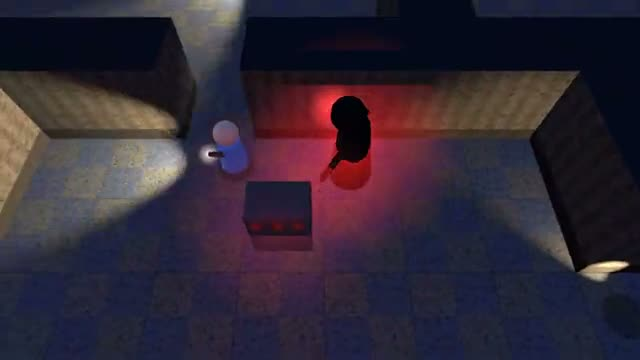

# Lights Out

Find the fuses. Don’t get caught. A multiplayer starter game from [Multiplayer Agent](https://multiplayeragent.com): 3D, co-op, 2–4 players, with bot teammates that fill empty seats.

## How it plays

The power is out. Search the dark building for the fuses with your flashlights and carry them to the breaker. Something is hunting you: it hears footsteps and sees flashlights. If it catches you, a teammate can get you back up.

**Controls:** WASD to walk, mouse to aim the flashlight, Shift to run, F for the flashlight, or the touch stick and buttons.

## Make it yours in the Game Builder

Open the [Game Builder](https://multiplayeragent.com), choose **Start from a starter game** and pick Lights Out. It opens as version 1 in your studio, ready to play and publish. Then ask for changes, for example:

- Add lockers you can hide in
- Make the flashlight batteries run out
- Add a second monster on hard mode

## Run it yourself

1. Get a free publishable key (`pk_…`) at [multiplayeragent.com](https://multiplayeragent.com).
2. In `index.html`, put it in place of `pk_REPLACE_ME` in the `MP_CONNECT` block.
3. Serve the folder (for example `npx serve`) and open it. The 3D engine loads as a module, which browsers block from a file on disk.

Without a key it still runs, offline with bot teammates.

## How it is built

- One `index.html` plus three.js in `libs/`. The comment at the top of the script maps the code and explains the multiplayer.
- The building is the text map in `CONFIG.map`: `#` wall, `x` crate, `f` a place a fuse can be, `B` breaker, `S` start, `M` monster.
- **Host-run rules:** The host's browser places the fuses, moves the monster and decides who gets caught; if it leaves, the next player takes over.
- **Bots:** AI teammates search, fetch fuses and revive you until friends join.
- **Rounds:** Each run starts, ends and restarts together for everyone.
- **Leaderboard:** The fastest escapes.
- `?attract` runs it offline with bots only. The preview video is recorded from it.

## License

MIT. three.js in `libs/` is MIT too (Copyright 2010-2024 three.js authors).
